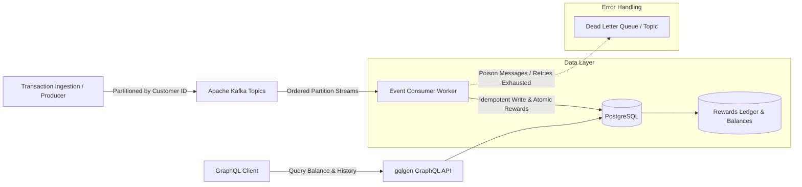

# EventPulse

EventPulse is an event-driven transaction and rewards processing pipeline built over Apache Kafka and PostgreSQL, featuring GraphQL querying via gqlgen.

## Architecture



## Core Guarantees

1. **Per-Customer Ordering via Partitioning**: Events are partitioned by customer ID so all events for a given customer are consumed sequentially.
2. **At-Least-Once Delivery with Idempotency**: Transactions use unique idempotency keys to ensure consumer restarts never double-process or double-credit points.
3. **Atomic Reward Updates**: Customer balances and ledger audit entries are committed within a single database transaction.
4. **Dead Letter Queue (DLQ) Separation**: Poison/unparseable messages route to a dead-letter queue, separating unrecoverable payloads from retryable transient failures.

## Local Setup

### Prerequisites
- Docker & Docker Compose
- Go 1.22+

### Running Infrastructure

Start Kafka and PostgreSQL using Docker Compose:
```bash
docker compose up -d
```

### Running Tests

Execute the test suite to verify delivery guarantees, idempotency, and ordering:
```bash
go test -v ./...
```
